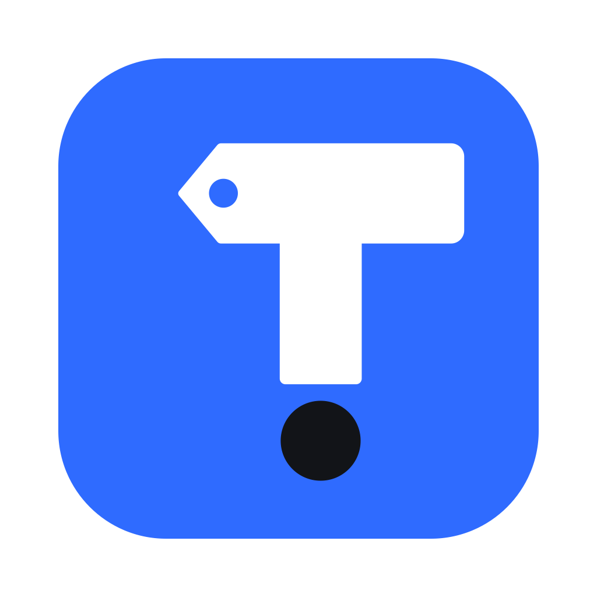

# Taggo

Editor di tag audio per macOS (SwiftUI + TagLib), ispirato al flusso di lavoro di Mp3tag.

## Requisiti
- macOS 14+, Command Line Tools di Xcode (Xcode completo non necessario)
- `brew install taglib`

## Uso
- `./build.sh` compila e crea `Taggo.app` in questa cartella (build di sviluppo, usa la TagLib di Homebrew)
- `./test.sh` esegue i test (lettura/scrittura reale su MP3, FLAC, M4A, OGG)
- `scripts/release.sh` crea la release in `dist/`: app universale (Apple Silicon + Intel) con TagLib inclusa, DMG, ZIP e SHA256. La versione è nel file `VERSION`.

Guida per gli utenti: [HOW_TO_USE.md](HOW_TO_USE.md).

## Icona
`Resources/AppIcon.png` (1024×1024) è generata da `swift scripts/make-icon.swift Resources/AppIcon.png`, che disegna il monogramma T! in vettoriale. Gli script di build la convertono in `.icns` da soli.

## Licenze
Taggo include [TagLib](https://taglib.org) 2.3.2 come libreria dinamica, sotto LGPL 2.1 / MPL 1.1 (testi in `Contents/Resources/Licenses`).

## Funzioni
- Apri o trascina cartelle (scansione ricorsiva), tabella ordinabile con colonne nascondibili, filtro
- Pannello di modifica multi-file: i campi con valori diversi mostrano `< mantieni >`; tasto destro → "Svuota campo"
- Copertine: aggiungi, trascina, rimuovi, esporta (HEIC/WebP convertiti in JPEG)
- Converti: Tag → Nome file (⌥1), Nome file → Tag (⌥2), Numerazione automatica
- Converti → Dividi in dischi (⌥⌘D)
- Azioni: Maiuscole/minuscole, Sostituisci (anche regex)
- Fonti: ricerca su MusicBrainz con copertina dal Cover Art Archive (⌥⌘M), Apri in MusicBrainz Picard (⌥⌘P), Cerca sul web (Discogs, AllMusic, Wikipedia, Last.fm, Bandcamp, Apple Music)
- Le modifiche restano in sospeso (pallino arancione) finché non salvi con ⌘S; all'uscita viene chiesto se salvare
